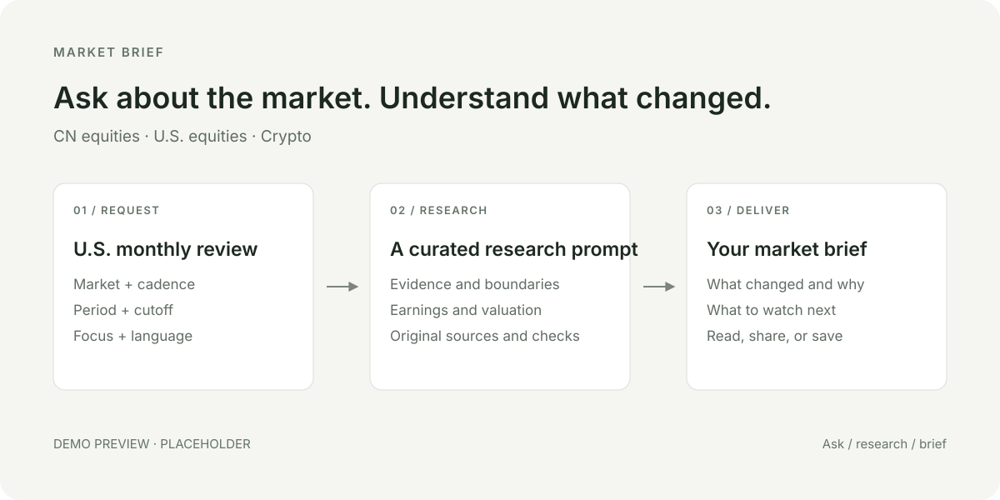

# Market Brief

Get a researched market brief for **China A-shares, U.S. equities, or Crypto**.
Understand what changed, why it matters, and what to watch next—with sources.

Market Brief is a curated library of 11 research prompts, packaged as an agent
skill. Your AI assistant does the research using the selected prompt.

<p align="center">
  
</p>

*Ask → research → brief. Demo recording coming soon.*

<!-- DEMO PLACEHOLDER
Replace assets/demo-placeholder.svg with assets/demo.gif when ready.
Record a 12-second loop at 1200 × 600, readable at 960 px:
0–3s: "$market-brief Review last week's U.S. equity market."
3–8s: show source checks and the report's date/cutoff.
8–12s: show the key conclusions, earnings analysis, and next week's outlook.
Use an actual run; the placeholder does not claim a completed demo.
-->

## Start here

### Copy and paste — no installation

1. Choose a prompt from the table below and open its file.
2. Click **Copy raw file** in GitHub's file toolbar.
3. Paste the full text into an AI assistant with web search enabled and send it.

For a specific date, language, or focus, add a sentence before the prompt:

```text
Review last week's U.S. equities. Write in Chinese and give extra attention to earnings.
```

If you leave the date out, the prompt tells the assistant how to choose the relevant
session or completed period. Attach an earlier brief if you want to compare with it.

### Use as a skill

Download this repository with **Code → Download ZIP** and unzip it. In Codex, open
the extracted folder and send:

```text
Install the market-brief skill from this folder into my personal skills directory.
Copy the complete folder, including assets/prompts.
```

Then start a new conversation and ask:

```text
$market-brief Prepare a China A-share premarket brief.
$market-brief Review last week's U.S. equity market, focusing on earnings.
$market-brief Give me a Crypto Daily Brief in Chinese.
```

Codex's personal skills folder is `~/.agents/skills/`. If the skill does not appear,
restart Codex. Other skill-capable assistants can load this folder using their own
installation instructions. See the [official Codex skills guide](https://learn.chatgpt.com/docs/build-skills#where-codex-loads-local-skills).

<details>
<summary>Command-line installation</summary>

```sh
git clone https://github.com/bitpunklabs/market-brief.git ~/.agents/skills/market-brief
```

For a project-only installation, use `.agents/skills/market-brief` in that project.
Choose one installation location to avoid duplicate entries. `main` tracks development;
use a reviewed release tag or commit when you need a fixed version.

</details>

## Choose your brief

| Market | Before trading | After trading / daily | Weekly review | Monthly review | Default language |
| --- | --- | --- | --- | --- | --- |
| China A-shares | [Premarket](assets/prompts/A股盘前prompt.md) | [Postmarket](assets/prompts/A股盘后prompt.md) | [Weekly](assets/prompts/A股周度复盘prompt.md) | [Monthly](assets/prompts/A股月度复盘prompt.md) | Chinese |
| U.S. equities | [Premarket](assets/prompts/us-premarket-prompt.md) | [Postmarket](assets/prompts/us-postmarket-prompt.md) | [Weekly](assets/prompts/us-weekly-review-prompt.md) | [Monthly](assets/prompts/us-monthly-review-prompt.md) | English |
| Crypto | — | [Daily](assets/prompts/crypto-daily-brief-prompt.md) | [Weekly](assets/prompts/crypto-weekly-review-prompt.md) | [Monthly](assets/prompts/crypto-monthly-review-prompt.md) | English |

Ask in your own words. Specify a date or period, information cutoff, language,
focus, or watchlist when needed. A focus adds attention; say **only** if you want
to restrict coverage. You can also ask the assistant to save the brief as a Markdown file.

## What you get

A complete brief with key conclusions, market and sector analysis, relevant
company or protocol developments, an outlook, and events or risks to watch.
The report states its time boundaries and cites important facts and figures.
The selected prompt determines the detail appropriate to its market and period.

You can also ask `$market-brief Show me the U.S. weekly prompt` to export it.

## What you need

An AI assistant with web search and access to sources. The skill has no runtime
package installation, API key setup, or Python requirement of its own; your
assistant may require an account or paid plan.

Data access and model capability affect results. Missing data should be identified
in the brief. Without web access, the assistant can export prompts or provide
clearly labeled non-current analysis. Historical briefs use information available
by the requested cutoff. These are research briefs, not investment advice.

## Help and improvements

If something is wrong, [open an issue](https://github.com/bitpunklabs/market-brief/issues).
Include your request, assistant, relevant report excerpt, and the source that shows
the problem. Remove private information before sharing.

The prompts in [`assets/prompts/`](assets/prompts/) are the single maintained source.
Normal use leaves them unchanged. Improvements are reviewed as focused edits based
on actual problems. See [Contributing](CONTRIBUTING.md) for maintenance and release checks.

Licensed under [MIT](LICENSE). See [changes](CHANGELOG.md) and [security reporting](SECURITY.md).
