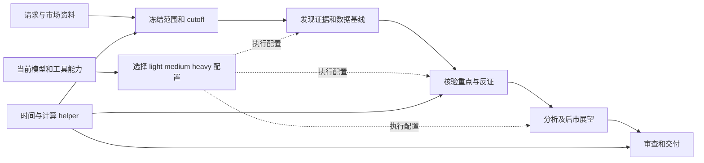

# Market Brief Skill：技术架构

日期：2026-10-07。状态：设计基线；第一批本地 skill/helper 已实现，宿主实际配置应用和真实研究案例尚待验收。实现边界见 [项目说明](../README.md)。功能与任务分档的唯一约定见 [功能设计](./market-brief-skill-design.md)。

## 1. 最小组成与职责

采用“宿主 agent + 可移植 skill + 一个确定性 helper”。宿主理解请求、读取当前运行能力、选择模型、使用工具和做研究判断；skill 维护研究方法、市场差异、频率职责与任务档位；helper 处理时间、计算和结构检查。

研究规则不绑定模型供应商，模型选择不绑定市场。agent 负责语义判断和分析，代码只验证取得的输入；不引入模型客户端、爬虫平台、工作流服务或数据库。

## 2. 包结构与加载

目标布局如下。当前已实现入口、registry、研究/市场/频率/execution 参考及 helper，并增加 references/records.md 说明其输入契约；hosts 参考尚未实现，不宣称适配已完成：

```text
skills/market-brief/
  SKILL.md
  registry.toml
  references/
    method.md
    equity.md
    crypto.md
    markets/<market_id>.md
    cadences/<cadence>.md
    execution.md
    hosts/{codex,claude-code}.md
  scripts/brief.py
```

`SKILL.md` 只保留入口、研究约束和加载条件。每次读 method、选定资产类型、市场与频率；执行需要委派/切换配置时读 execution 和当前宿主参考。registry 维护机器读取的市场元数据与任务档位；市场 Markdown 只维护研究差异，避免同一字段两处维护，也不为读取配置增加 YAML 解析依赖。

来源中的 `skills/` 是作者目录，发现路径由宿主安装约定决定。可选 `agents/openai.yaml` 仅承载 Codex 展示信息，不保存 model/effort。host 参考只说明能力取得与调用方式，不预置固定模型角色文件。没有用到的市场、宿主或状态资料不加载。

入口蓝图只需以下约束，具体档位和字段放 supporting references，以下不是已安装文件：

```markdown
---
name: market-brief
description: Research and deliver source-backed market briefs and reviews for configured global markets, with market-specific time boundaries and conditional outlooks.
---
Resolve the market, cadence and language from the request and registry.
Read the shared method and the selected asset, market and cadence references.
Freeze the research window using actual time and calendar evidence.
Use light/medium/heavy task requirements; select supported execution settings from current host capabilities.
Discover broadly, verify material sources and counterevidence, then analyze and write the brief.
Check calculations and temporal boundaries, and review the support for core claims.
Deliver the report itself with nearby citations and substantive conditional outlooks.
Use actual previous reports when available; narrow unsupported conclusions and disclose material data gaps.
```

## 3. 稳定任务与流程

任务 ID 和默认档位只采用功能设计第 5 节的定义；registry 按三档维护短任务列表，helper 可检查合法档位，不能用档位自动推导研究结论。任务合并、查询数量与是否委派由 agent 按工作量决定，无需通用任务图。



主 agent 始终承担整体研究与交付责任。小任务直接在当前会话完成；只有能减少实质工作或等待的窄任务才委派。无需为每个档位、阶段或报告章节创建一个 agent。

## 4. 动态档位绑定

### 4.1 读取本次实际能力

先用宿主当前暴露的模型选择工具/调用元数据或能力接口，取得候选模型、每个模型的 effort 选项、默认配置和相关工具/权限。记录来源、取得时间及候选范围是完整还是部分。公开产品目录与静态 allowlist 只是候选线索，不证明当前账号授权或本次调用可执行。

优先使用当前会话已提供的信息；确有宿主接口且允许访问时再读取。不为列模型新增服务、遍历密钥或执行付费探测，也不要求用户手工维护版本清单。宿主不暴露列表时以当前可确认会话配置为唯一候选，effort 不可选就保持默认。

能力读取与首次绑定由当前主 agent 完成，不要求先选择一个 medium 模型才能执行 resolve；任务表是后续分配参考，不形成模型选择的循环依赖。

### 4.2 agent 选择三档

agent 在已知候选中按任务能力、工具适配、可用上下文以及宿主提供的相对速度/消耗信息，选择本次 `light / medium / heavy` 配置并写一句理由：light 适合窄范围发现与整理，medium 适合抽取与范围理解，heavy 优先满足关键核验与复杂分析。

不按模型名称、版本数字或 effort 字符串排序猜能力；缺少价格资料不虚构精确成本。只可选择该模型当前支持的 effort，heavy 不必 max；遵循当前模型说明，也可以同模型不同 effort，或三档全部共用一套配置。没有可比较信息时保守沿用当前模型，不宣称已找到最优组合。

映射只在本次运行内有效，不写回 skill 或全局设置。能力失效、宿主拒绝配置或工具不足时才重新选择受影响档位；不逐页检索都重新选模。新的运行重新取得当前能力，不沿用上次过期 model ID。

本轮已被拒绝的配置不重复尝试；没有合适替代时沿用可执行配置并记录原因，不让能力刷新形成重试循环。

### 4.3 应用与实际执行分开

研究子任务只传 `task_id` 与所需档位；主 agent 查本次绑定，使用宿主实际支持的调用参数或会话级机制执行。选择方案由 agent 判断，设置参数的机械动作由宿主完成；helper 不调用模型。

主会话不能逐阶段更换配置时，配置可作用于支持覆盖参数的子任务。没有委派或配置覆盖能力时在当前会话执行相同研究职责，并记为 inherited/uncontrolled；三档逻辑要求仍保留，不伪称实际发生三档模型切换。

请求配置、宿主接受配置、可确认的实际配置分别记录。宿主只能选择模型但不能按子任务覆盖 effort 时使用可确认的默认/继承值；不将期望 effort 当实际值。实际模型/effort 不可观测时为 unknown。

默认自动适配当前能力，禁止为了满足三档数量强行选三个不同模型。若无法执行足够的关键研究或取得证据，降低结论或明确未完成；缺少多模型路由本身不等于研究必须 partial。第一版不增加 strict/best_effort 双模式与额外用户开关。

## 5. Codex 与 Claude Code 的薄适配

共同契约只有“取得当前能力、应用所选配置、记录可观察结果”三项。它是操作约定，不预建 adapter 类层次、供应商评分器或 runner 服务。

| 宿主 | 取得候选与 effort | 应用边界 |
| --- | --- | --- |
| Codex | 已暴露的调用元数据；已有 App Server 可访问时使用 `model/list`，读取实际返回选项并处理分页 | 使用可用子任务参数/配置机制；自定义 agent 的固定 model/effort 可能覆盖调用选择，须识别冲突，不预装固定角色 |
| Claude Code | 宿主实际可访问的选择信息、组织限制与当前 effort 能力；公开 aliases 或 allowlist 不当作授权清单 | 使用宿主支持的子任务 model 与 effort 机制；effort 覆盖可能受环境/管理策略影响，按实际支持处理 |
| 未暴露选择能力的宿主 | 当前可确认配置 | 沿用当前会话并记录限制，仍执行同一研究方法 |

Codex 官方定义了 `model/list` 与 `supportedReasoningEfforts`，但部分 provider 下返回的是目录而非授权校验，故需要区分候选与实际执行。见 [OpenAI App Server](https://learn.chatgpt.com/docs/app-server) 和 [目录与授权边界](https://developers.openai.com/siwc/token-sharing-open-source/codex-app-server)。

Codex 自定义 agent 可设置模型和推理强度，配置优先级须依当前宿主处理，见 [Codex 子 agent](https://learn.chatgpt.com/docs/agent-configuration/subagents)。Claude Code 支持子 agent model 和 effort，但可用选项与覆盖限制随模型、组织和运行环境变化，见 [Claude Code 子 agent](https://code.claude.com/docs/en/sub-agents) 与 [模型配置](https://code.claude.com/docs/en/model-config)。

Skill 可以要求动态选择，不因此获得未暴露的宿主能力。适配说明需随目标客户端版本核验，安装同一 skill 不保证所有宿主都有同等自动切换能力。本轮不修改宿主设置或验证账号实际可用模型。

## 6. 可扩展市场资料包

`market_id` 表示报告研究范围，既有 cn_equity/us_equity/crypto 不变。股票共用 equity 方法，连续数字资产共用 crypto 方法；市场包只描述地方差异，没有多层继承或条件开关组合。

| 市场包字段 | 用途 |
| --- | --- |
| id、资产类型、覆盖范围/交易所、主基准 | 决定研究对象与市场范围；不把国家名或 ticker 字符串当唯一标识 |
| 支持频率、时段类型、主时区、市场周定义、日历来源 | 决定默认目标与区间规则；交易时段由本次日历/来源确认 |
| 基准币种、分类/比较口径、主要来源 | 区分本地与共同币种、行业与主题、统计范围 |
| 市场机制与披露限制 | 影响分析的交易约束、资金/持仓迟报、财报和治理惯例 |

机器需要的字段只维护在 registry 对应市场条目；市场参考只放影响研究决策的特有方法与来源说明，不写另一条完整 prompt。二者共同组成一个市场资料包。语言规则统一为 CN 中文、其余英文、显式要求优先，无需每个新市场重复配置。

扩展步骤：新增市场参考 → 在 registry 登记元数据/别名 → 补一个完整研究案例和相关时间/口径反例 → 验收后开放对应频率。HK/日本等首个新增股票市场不应改公共研究流程或模型分档。确有新字段、计算或资产经济差异时才扩展契约。

对于复合区域范围，选择区域基准与主报告窗口，同时在实际 Evidence/Observation 上记录各市场日历、行情端点和币种；不足以定义范围时先澄清。单市场仍使用一套 context，不为未来复合区域先建立多市场调度系统。跨市场比较只在窗口/收益/币种可比时形成统计结论，否则分列并说明边界。

## 7. 时间与证据契约

本次 `as_of` 在研究开始冻结，生成/取得时间与信息截止分开。股票价格按真实交易时段边界，连续市场 daily 按 24 小时、weekly 按完整 UTC 周、monthly 按 UTC 自然月；市场周起止约定由市场包明确，不把全球股票周都假设为周一至周五。

连续市场首版采用 UTC 周一 00:00 至下一周一 00:00 的完整周；信息窗口记录包含/排除边界，结束时间是下一期起点时采用不含结束的窗口，避免将下一期零点发布纳入上一期。

盘前包含此前收盘之后的相关休市窗口；盘后主体只使用常规时段可知信息，期后消息另列。固定历史期未给 as_of 时采用 period_default：盘前开盘前、盘后常规收盘、股票周报该周最后实际常规收盘、连续市场周/月报与股票月报对应自然期末边界；新闻截止和最后行情时点分开保存，期后更新只有显式要求才加入。股票默认周报在本周全部实际交易时段完成后即可选本周，完全休市周不作为默认已完成交易周。股票月报的自然月信息截止不允许月末最后收盘后的材料进入此前价格归因。

取得真实时间及相关日历材料后，helper 才能确定时段，缺材料返回 pending。参考中的时段规则与公开网页日期不能证明当天开盘、版本或历史可用性；历史网页的后来追加内容不得凭最早发布日期进入当时归因。

研究中有新发布也不无记录地扩展 cutoff。确要更新则新建版本并重算相关窗口、行情与判断。前瞻从指定 cutoff 开始，已发生部分与未来条件分开。

## 8. 最小研究记录

采用 `Evidence → Observation → Claim → BriefDocument`，只结构化关键资料和判断。主 agent 保持对支持度、机制与反证的语义责任，代码校验不构成事实正确证明。

| 记录 | 必需信息 |
| --- | --- |
| context | 请求与范围、目标期、as_of/生成时间、主时区、价格端点、允许期后更新、日历材料与核验状态 |
| evidence | id、URL/发布者、实际读到的支持片段/定位、公开及版本时点、取得时间、所属期与时间精度 |
| observation | id、证据引用、实体/市场/样本、值/单位/币种、期间与收益口径、计算输入和方法 |
| claim | id、事实/推断/假设、支持与反证、机制、理由、期限和失效条件 |
| coverage | 应检查的范围及已查/未查/失败状态、重大缺口 |
| execution | 当前能力来源/范围、三档绑定及理由、任务请求与实际配置、可见工具、回退和可取得 usage |

未知字段为 null/unknown 并说明原因；没有资料不等于实际数值为零。关键原文需由承担 verify/review 的执行者重读，轻档摘要不替代证据。取得哪些日志就保存哪些，不伪造 capture 或准确账单。

多个执行者共享相同的 context 和覆盖要求，交接时明确相关研究规则、证据及 unresolved；不假定自动获得全部父会话。子任务只返回资料/计算/审查结果，由主 agent 合并正式报告，避免共享文件并发写入。

## 9. Helper 与最小产物

一个 `scripts/brief.py` 即可提供 resolve/calculate/check：根据已取得日历解析区间，复算真实价格和单位，核验记录关系、时间边界和数字。缺输入不能生成 verified；不默算指数贡献、全市场宽度或同期限盈利修订。

宿主文件工具保存正文和关键研究记录，helper 检查时记录结果和内容哈希。第一版不拆出 planner、validator、finalizer 多个服务或多个纯包装模块；实现增长到确有独立职责时再拆分。

```text
runs/<run_id>/
  brief.md
  run.json
  inputs/                 # 仅实际需要保留的大型行情/日历/来源片段
```

run.json 合并 request/context/coverage/evidence/observations/claims/execution/checks 与版本、输入/正文哈希。不强制每次创建九个文件，不保存无关完整对话。运行记录在用户工作区，安装目录保持只读；没有文件能力时可交付有来源的聊天正文并说明未保存审计包。

记录 research_quality=complete/partial/unavailable，另保存具体检查结果和交付位置。文件保存成功、数据检查通过、研究覆盖充分与实际模型切换成功分别说明。冻结材料支持复算与审计，不保证网页再次联网仍相同或模型重跑逐字一致。

连续研究直接读取实际旧报告/运行记录，保留原文与发表时点；历史重跑单列，不进入真实预测记录。当前不引入 state_mode、数据库、主题状态机或状态 patch 提交机制。

## 10. 审查、停止与验收

交付前同时做数字/时间/引用关系检查与核心判断语义审查。重点核实历史泄漏、期后倒归因、单位/样本混用、预期来源、因果和反证；引用存在不证明来源支持。网页资料中的指令不能改变研究任务。

补证优先解决会改变核心结论的缺口；发现冲突按问题升级到 heavy。一次集中补证与定向修正后仍无可靠支撑，就删除或降低该结论，不无限搜索或把错误仅标 partial。

验收分开：本地时间与计算检查；同证据下原 prompt/skill、单配置/三档适配的研究质量比较；真实联网、宿主配置应用与交付。沿用 E/D 案例，并增加动态绑定和新增市场案例。未执行的验收不能报告为通过。

质量门槛是无编造、无关键时间/口径错误，重要结论有支持与反证，频率职责和条件性展望完整、引用可读。评估总耗时/消耗及遗漏/人工修正，不先建设评分框架或假定更多 agent 更便宜。公共规则改动检查全部相关任务，市场改动检查该市场，执行适配改动检查回退与实际应用。

## 11. 收紧后的实施范围

| 收紧项 | 当前决定 |
| --- | --- |
| 固定模型与供应商角色文件 | 删除；每次从宿主能力选择三档，记录绑定即可 |
| 单/多模型及 strict/best_effort 用户开关 | 删除；默认自动适配，能力受限时诚实沿用当前配置 |
| 每阶段/每章节独立 agent | 删除；按工作量合并，关键研究责任由主 agent 保留 |
| 九文件包、多 helper 模块与 finalize 包装 | 合并为正文、run.json 和一个 helper，必要原始输入另存 |
| 主题状态机与档案写入协议 | 延后；先用实际旧报告与检查点支持连续研究 |
| 独立规则目录与量化评分系统 | 去重；核心规则落在研究规范，反例留作验收，不再维护重复目录 |
| 全球市场大规模预配置 | 延后；先用新增市场包证明扩展边界，无新字段不改核心 |

实施只需三步：先让一个任务生成真实可读报告并保留关键记录；补 helper 与三档宿主适配，覆盖 CN/US/Crypto 的不同时间语义；扩展全部原任务并用第一个新增股票市场验证可扩展性。始终交付报告，不以生成 prompt、配置文件或计划代替完成研究。

## 12. 验收案例

### 12.1 既有研究边界

| 案例 ID | 输入情境 | 预期行为 |
| --- | --- | --- |
| `E01` | A股长假后盘前 | 窗口包含整个休市期，不截断为 24 小时 |
| `E02` | A股短交易周和完全休市周 | 选正确完整交易周；短周比较日均，完全休市周不冒充交易周 |
| `E03` | 美股夏令时切换、节假日与提前收盘 | 使用日历和实际时区，双时区日期与时间正确 |
| `E04` | 收盘后财报大幅下调指引 | 进入盘后更新，不解释财报公布前的常规时段走势 |
| `E05` | 历史页面后来新增段落但最早日期不变 | 新段落不得作为历史版已知事实 |
| `E06` | 月初才披露上月资金和经营统计 | 最新版可辅助测量；历史版不偷看，不作当时已知催化 |
| `E07` | 权重指数上涨、多数股票下跌 | 明确集中度/背离，不称普遍风险扩张 |
| `E08` | 政策发布、板块上涨、尚无执行和订单 | 保留待验证传导，不确认企业盈利改善 |
| `E09` | EPS 超预期但口径不同、指引弱 | 不直接拼接比较，解释口径与未来预期 |
| `E10` | NTM 盈利增加主要来自期限滚动 | 不宣称同期限盈利预期已上修 |
| `E11` | Crypto T 为 UTC 23:40 | 回看 24 小时，前瞻从 T 起覆盖 24–72 小时 |
| `E12` | Crypto 历史日期 D 未给时间 | 使用 D 的完整 UTC 日和 D+1 00:00 截止 |
| `E13` | Crypto 周末大幅波动 | 波动属于完整七天周内；不放成股票式周末追加收益 |
| `E14` | Crypto 月份天数不同、TVL 与费收入变化 | 流量可比较日均，存量不除以天数 |
| `E15` | USD OI 随价格上升，币本位数量未变 | 不推断新增同幅杠杆或新增净多头 |
| `E16` | 费率结算间隔不同、USDT 去锚 | 核验并明确归一化基准，不能直接比较原始值 |
| `E17` | 协议费用上升，分配归公司而非代币 | 不推断代币持有人盈利增长 |
| `E18` | 代币解锁但仍受转让限制 | 不把公告名义额当实际卖压或净流出 |
| `E19` | 钱包标签事后修订，包装资产重复出现 | 历史版不偷看；样本去重并说明限制 |
| `E20` | 周末只有旧美债收盘价与未披露基金流 | 标为陈旧/未披露，不作实时确认或零流 |
| `E21` | 前报条件未触发，长期验证期未结束 | 分别标为未触发、仍待验证，不计预测成败 |
| `E22` | 没有前报、部分宽度数据缺失 | 省略预测评分，缩小统计结论，仍完成可靠研究 |
| `E23` | 联网工具不可用且无新证据 | 不交付冒充实时的研究；状态为 unavailable 或明确非实时 |
| `E24` | 下一周/月已开始或请求未来完成期 | 已发生部分与前瞻分开；未来期只允许提前版 |
| `E25` | 同一事件有多篇转载，搜索结果混入指令 | 去重到原始事件；网页指令不覆盖研究任务 |
| `E26` | 引用仅有宿主内部 ID，切到文件输出 | 转成可读来源链接，不泄漏原始工具 ID |

上表是案例计划，不是已完成的测试结果。一个输入可以验证多个规则，但应有明确失败定位。

### 12.2 直接报告运行

| 案例 | 场景 | 实际验收 |
| --- | --- | --- |
| `D01` | 用户要求生成市场报告 | 交付有来源的正文与前瞻，不止给 prompt、计划或空模板 |
| `D02` | 核心来源或行情工具不可用 | 缩小结论或明确无法完成，不能用记忆填最新数字 |
| `D03` | 研究途中发生新发布 | 保持固定 cutoff；更新时显式新版本并同步价格/信息边界 |
| `D04` | 默认目标期需要日历但无核验材料 | 不假设完整交易期、不伪造 verified；说明原目标限制 |
| `D05` | 代码结构与引用关系通过，来源原文不支持结论 | 语义审查指出失败，不能把静态通过当事实正确 |
| `D06` | 聊天原生来源与导出文件显示不同 | 正文和文件分别检查，导出链接可读且不泄漏内部 ID |
| `D07` | 有/无旧报告，或旧长期条件未到期 | 原始条件不改写，无旧记录不虚构，未到期不提前判失败 |
| `D08` | 部分可靠结果可交付，但关键判断未核实 | 缩小或删除该判断、说明局限；保存 partial 不表示研究完整 |

### 12.3 动态绑定与全球市场

| 案例 | 输入情境 | 预期行为 |
| --- | --- | --- |
| `L01` | 当前候选列表增加/移除模型或 effort | 新运行用新列表，只选择有效组合；不读取固定型号绑定 |
| `L02` | 只有一个可用模型，或 effort 不可覆盖 | 三档可合并，使用可确认配置，不伪称切换成功 |
| `L03` | 模型在目录中但调用拒绝，或工具权限不满足 | 排除本次失败组合，重新选择受影响档位或沿用当前会话；记录原因 |
| `L04` | 宿主不暴露列表、只有静态 allowlist | 不声称获得完整授权列表；记录实际可确认候选范围 |
| `L05` | 宿主固定配置或环境覆盖动态请求，实际信息不可观测 | 请求与实际分开，未证实写 unknown；不能把设计选择当执行结果 |
| `L06` | light 漏事件/抽错核心数字，子任务 cutoff 不同 | heavy 复核覆盖与原文、代码复算；拒绝越界合并，修正受影响判断 |
| `G01` | 加入 HK/日本等首个新股票市场 | 只加市场包/索引/案例即可运行；默认英文，原 task 不回归 |
| `G02` | 复合欧洲范围、不同交易日与币种 | 先确定基准/范围，保留各端点，不混算不同时点本币收益 |
| `G03` | 新市场的短周、夏令时或不同市场周约定 | 按该市场实际日历与周定义，不复用 CN/US 的假日与时段 |
| `G04` | 尚未登记市场或不支持频率 | 不宣称全球覆盖已实现，说明需要补市场包/频率案例 |

每个原任务至少一个冻结案例，保存证据、行情/日历和评审标准；多机制可以合理，不设唯一报告答案。语言与迁移质量分开比较。检查原始来源支持、实际工具使用与读者可读性，不以标题/配置正则匹配替代研究评估。

以上是验收计划，不能整体视为已通过。当前本地测试覆盖部分时间、收益、引用与执行记录边界；合成输入不证明原始资料真实性、动态模型选择、宿主配置应用或联网报告已运行。实际验证命令与下一批范围见项目说明。
